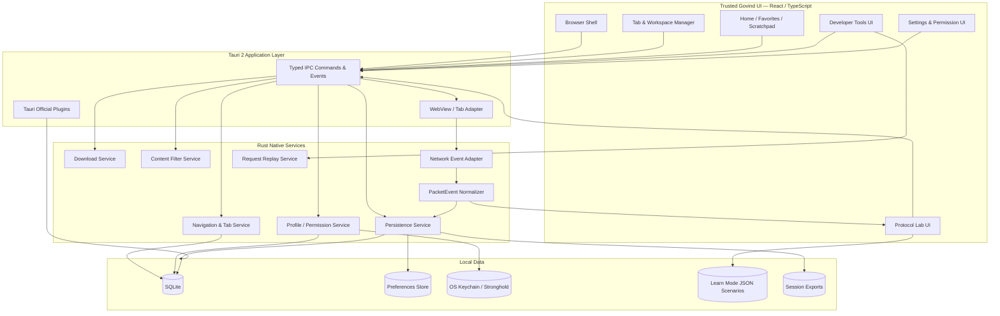

# GOVIND BROWSER
## Product Requirements, System Architecture, Engineering Workflow & Delivery Plan

**Document version:** 2.0  
**Status:** Expanded product specification / architecture decision pending  
**Product:** Govind Browser  
**Tagline:** *A fast browser that shows you how the internet works.*  
**Target:** Windows desktop first; Linux next; macOS later  
**Architecture direction:** React/TypeScript UI + Rust services; desktop engine decision is conditional (Tauri/WebView2 feasibility gate versus Chromium/CEF); Android uses a separate WebView or GeckoView implementation  
**Design identity:** Distinctive Sunrise Fusion / Sunrise Orange, with the uploaded `arc_zen_minimalist_browser.html` as the current frontend starting point

---

## 0. Executive Summary

Govind Browser is a privacy-first, productivity-oriented browser with three connected product areas:

1. **Everyday browser:** vertical tabs, task-based groups, workspaces, profiles, split view, bookmarks, history, downloads, reader tools, autofill, page search and session time-travel.
2. **Developer workspace:** request inspection/replay/mocking, bug-session recording, responsive multi-viewport testing, localhost server dashboard, per-tab identity profiles, local documentation lookup and controlled agent access.
3. **Protocol Lab:** an integrated learning and debugging environment that explains web communication through OSI layers, protocol details, event timelines and educational playback.

The expanded product vision includes the full feature catalogue in this document. It does **not** mean every feature belongs in the first release. Ship a small number of differentiated capabilities exceptionally well, then add baseline browser parity and advanced automation in gated releases.

### Product principles

- Browsing must remain the primary activity; advanced tools should not overwhelm it.
- Protocol Lab must distinguish real observations from educational illustrations.
- Privacy-sensitive features must be opt-in, local-first and transparent.
- Native capabilities belong in Rust; interface composition belongs in React.
- Use established libraries and plugins for commodity features instead of writing infrastructure manually.
- Every feature must have an explicit phase, acceptance criteria and test coverage.

### Critical architecture decision

Tauri is an application framework, not a browser engine. Tauri 2 on Windows normally uses WebView2 through Wry. That can be a good lightweight shell, but the expanded requirements—Chrome-like tab isolation, request interception/replay, CDP access, multi-viewport emulation, extension compatibility, robust profiles and detailed network instrumentation—depend heavily on engine-level APIs.

**Architecture recommendation for the complete vision:**
- Keep React/TypeScript for the trusted application UI and Rust for shared native services.
- Run a mandatory engine spike before committing to Tauri as the browser engine.
- If the product must deliver deep Chromium DevTools Protocol access, reliable network interception, device emulation and extension compatibility, prefer a Chromium-based embedding strategy (CEF or a maintained Chromium shell/fork) for desktop.
- Use Tauri/WebView2 only if the spike proves the required capabilities and limitations are acceptable. Tauri may remain useful for a lightweight utility shell, but it should not be assumed to provide full browser-engine control.
- Treat Android as a separate implementation: Android System WebView is the lightest route; GeckoView is an alternative if stronger engine-level control is required.

**Mandatory feasibility spike:**
- Host at least three independent website views in one browser window.
- Verify navigation, history, cookies/storage isolation, pop-ups, downloads and permission handling.
- Verify CDP or equivalent access for request lifecycle, console, DOM snapshot and emulation.
- Prove request interception, response mocking and replay without a local proxy.
- Verify that trusted app IPC is inaccessible to remote website content.
- Measure memory and CPU at 1, 5, 10 and 20 tabs.
- Validate licensing, update strategy, platform support and long-term engine maintenance.

If this spike fails, change the engine decision before implementing the feature backlog. A Tauri-first prototype must not create a false assumption that every browser feature can be added later.

---

# 1. Product Definition

## 1.1 Problem

Users currently need separate products to browse, learn how web protocols work, inspect requests and manage research sessions. Browser developer tools are powerful but not designed as a guided learning experience. Educational protocol visualizers are usually disconnected from the user's real browsing context.

Govind combines normal browsing with a learner-friendly Protocol Lab.

## 1.2 Goals

| ID | Goal | Success measure |
|---|---|---|
| G-01 | Provide a reliable desktop browsing experience | Core navigation and tab workflows pass automated tests |
| G-02 | Make protocol behavior understandable | Six offline learning scenarios ship with step-by-step explanations |
| G-03 | Make research sessions easier to manage | Workspaces, favorites, scratchpad and session restore work reliably |
| G-04 | Give developers useful request visibility | Inspect method, URL, status, headers, timing and resource type where exposed by the engine |
| G-05 | Protect user privacy | No telemetry by default; capture disabled by default; local-first storage |
| G-06 | Keep the application lightweight | Establish and publish repeatable startup, idle-memory and multi-tab benchmarks |
| G-07 | Reduce implementation effort | Reuse Tauri plugins, Rust crates and proven React components for commodity features |

## 1.3 Non-goals for the first release

- Building a new rendering engine.
- Full Chrome DevTools parity in the first release.
- Guaranteed access to every raw packet on the network interface.
- Router-internal hop visibility without a separate capture mechanism.
- Full Chrome Web Store compatibility without an explicit compatibility program.
- Cloud sync in the first MVP.
- AI browsing features enabled by default.
- A single shared codebase for desktop and Android browser engines.

## 1.4 Target users

| Persona | Main need | Primary features |
|---|---|---|
| Student / learner | Understand how the internet works | Learn Mode, OSI selector, sequence diagram, packet playback |
| Web developer | Inspect and reproduce requests | Network inspector, request details, copy-as-cURL, replay |
| Research / power user | Organize many browsing tasks | Workspaces, vertical tabs, favorites, scratchpad, session restore |
| Privacy-conscious user | Control browser data and permissions | Site permissions, HTTPS-first, content blocking, local data controls |

---

# 2. Product Scope and Feature Catalogue

Priority definitions:

- **P0 — MVP:** required for the first usable release.
- **P1 — Next release:** valuable, but must not block the MVP.
- **P2 — Later:** advanced capability or high-risk integration.

## 2.1 Browser shell and navigation

| Feature | Description | Priority |
|---|---|---|
| Native application window | Frameless or custom title bar, minimize, maximize, close | P0 |
| Address / search bar | Accept URLs and search queries; normalize input | P0 |
| Back / forward / reload | Browser navigation controls | P0 |
| Home / new tab | Open the Govind start page | P0 |
| Tab management | Create, activate, close and reorder tabs | P0 |
| Multi-WebView tabs | One independent web content view per tab | P0 technical gate |
| Loading state | Progress indicator, favicon and page title | P0 |
| Site identity | Display origin and security state based on actual engine information | P0 |
| Find in page | Search text in the active page | P1 |
| Zoom | Per-tab zoom controls | P1 |
| Pop-up handling | Controlled new-window and pop-up behavior | P1 |
| Download manager | Progress, destination, pause/cancel where supported, open file | P0 |
| Print | Native print flow | P1 |
| PDF viewing | Use WebView's built-in PDF support where available; validate platform behavior | P1 |
| Import / export | Import bookmarks and selected browser data | P1 |
| Restore session | Reopen last session after explicit user setting | P1 |

## 2.2 Workspaces and productivity

| Feature | Description | Priority |
|---|---|---|
| Workspaces / Spaces | Separate tab collections such as Research and Studio | P0 |
| Favorites | Pinned website shortcuts | P0 |
| Bookmarks | Save, edit, delete and organize URLs | P0 |
| History | Local browsing history with search and clear controls | P0 |
| Quick notes / Scratchpad | Save local notes while browsing | P0 |
| Command palette | Search tabs, workspaces, bookmarks and commands | P1 |
| Vertical tabs | Sidebar-based tab list | P1 |
| Tab groups | Group related tabs | P1 |
| Session restore | Restore tabs and workspace state | P1 |
| Reader mode | Extract readable article content and render in a calm reading layout | P1 |
| Split view | Show two pages side by side | P2 |

## 2.3 Protocol Lab

### Modes

1. **Learn Mode (P0):** deterministic offline scenarios with known events and explanations.
2. **Live Mode (P1):** show actual browser-observed request/resource events, with clear limitations.
3. **Replay Mode (P1):** replay a saved event sequence for debugging or teaching.

### Protocol Lab layout

- Protocol navigation drawer.
- Protocol search.
- OSI layer selector (1–7).
- Network / Sequence view switch.
- Interactive network canvas.
- Protocol overview inspector.
- Packet Flow timeline/table.
- Playback controls: play, pause, step forward, step backward, reset.
- Playback speed: 0.5x, 1x, 2x.
- Protocol filters and event details.

### Learn Mode scenarios — P0

| Scenario | Teaching sequence |
|---|---|
| URL to page | URL parsing → DNS → connection → TLS (HTTPS) → HTTP request → response → rendering |
| DNS lookup | Stub resolver → recursive resolver → authoritative response (simplified) |
| TCP handshake | SYN → SYN/ACK → ACK |
| HTTP request / response | Request line, headers, status, response headers and body |
| HTTPS / TLS | ClientHello, certificate, handshake concepts, encrypted application data |
| HTTP/2 overview | Multiplexed streams, frames and shared connection |

Educational scenarios must be stored as versioned local JSON files. Every event should include an explanatory label and source classification such as `educational`.

### Live Mode — scope and truthfulness

The first live implementation should observe events exposed by the embedded browser engine, for example navigation, resource requests, response metadata, status, headers and timing where available.

It must not claim to show:
- Physical Ethernet frames when only browser resource events are available.
- Internal router hops.
- Raw encrypted TLS payloads.
- DNS packets or TCP handshake internals unless the capture source actually provides them.

Every event must carry a source field, for example:
- `engine_observed`
- `proxy_observed`
- `os_capture`
- `educational`

The UI must label illustrative network nodes and inferred values. Do not present a browser request event as a complete packet capture.

## 2.4 Developer workspace

| Feature | Description | Priority |
|---|---|---|
| Network request list | URL, method, status, type, size and duration | P1 |
| Request detail | Request/response headers and available payload metadata | P1 |
| Copy as cURL | Generate a command from captured request fields | P1 |
| Copy as Fetch | Generate a Fetch snippet | P1 |
| Replay request | Resend an editable request through a controlled Rust HTTP client | P1 |
| Mock response | Return a local mock response in a controlled test workflow | P2 |
| Console | Capture application console messages where engine integration permits | P2 |
| Storage viewer | Inspect selected origin storage with explicit permission | P2 |
| Session recorder | Export a replayable event bundle, with sensitive fields redacted by default | P2 |

## 2.5 Privacy and security

| Feature | Description | Priority |
|---|---|---|
| Site permission manager | Camera, microphone, location, notifications and pop-ups | P0 |
| Clear browsing data | History, cache, cookies and site data, with clear scope | P0 |
| Private window | Separate ephemeral browsing session | P1 |
| HTTPS-first | Prefer HTTPS and provide clear failure behavior | P1 |
| Content blocking | Filter-list-based request blocking | P1 |
| DoH | DNS-over-HTTPS through a selected resolver | P2 |
| Fingerprinting controls | Restrict selected surfaces where technically supported | P2 |
| Password manager | Encrypted local vault; separate security review required | P2 |
| No default telemetry | Telemetry disabled unless user opts in | P0 |
| Capture privacy | No request bodies, cookies, passwords or authorization headers stored by default | P0 |

---

# 3. Design and Frontend Baseline

## 3.1 Uploaded UI source review

The uploaded `arc_zen_minimalist_browser.html` is a single-file HTML mockup with:
- Tailwind CSS loaded from a CDN.
- Google Fonts: Newsreader, Plus Jakarta Sans and JetBrains Mono.
- Warm paper background, sage accents and a coral accent.
- Left sidebar with Research / Studio workspaces, favorites and open tabs.
- Top navigation / omnibar with back, forward, reload, home and URL input.
- Scratchpad panel.
- Command palette.
- Settings modal.
- Downloads panel and more-options menu.
- Reader mode and fullscreen toggles.
- Keyboard shortcuts including Ctrl+K, Ctrl+T, Ctrl+L, Alt+R and F11.

The current HTML is a **visual interaction prototype**, not a functioning browser engine. Several handlers only show toast messages or change mock text. Examples include navigation, new tab creation, history, extensions, downloads and window feedback. The implementation must replace these mock handlers with native/browser services.

The file also contains sample content and sample security text. Do not treat the displayed certificate, TLS version, tracker status, sync status or download information as verified runtime facts.

## 3.2 Frontend migration tasks

- Convert the single HTML file into React components without changing its visual hierarchy unnecessarily.
- Extract theme tokens into CSS variables.
- Replace CDN Tailwind runtime with a pinned local build for production.
- Bundle fonts locally or provide robust system fallbacks.
- Replace inline `onclick` handlers with typed React event handlers.
- Replace direct DOM manipulation with application state.
- Add route / panel state for Home, Browser, Protocol Lab, Developer Tools and Settings.
- Add loading, empty, error, permission-denied and offline states.
- Add keyboard navigation and accessible labels.
- Use a clear boundary between trusted application UI and untrusted web content.
- Keep the current mock UI as a reference fixture until the React version passes visual comparison.

## 3.3 Design system

The current HTML uses a warm paper / sage direction. The latest design direction requested for Govind is **Sunrise Orange / Sunrise Fusion**. Treat the latest direction as the target product theme and the HTML as a layout and interaction reference.

Suggested design tokens:

| Token | Value |
|---|---|
| `--govind-bg` | `#FFFCF8` |
| `--govind-panel` | `#FFF5EC` |
| `--govind-surface` | `#FFFFFF` |
| `--govind-border` | `#F1D7C5` |
| `--govind-text` | `#292524` |
| `--govind-muted` | `#78716C` |
| `--govind-primary` | `#F97316` |
| `--govind-primary-strong` | `#C2410C` |
| `--govind-peach` | `#FFEDD5` |
| `--govind-success` | `#16A34A` |
| `--govind-warning` | `#D97706` |
| `--govind-danger` | `#DC2626` |

Use sunrise visuals selectively on the homepage and Protocol Lab. Keep ordinary web content neutral and distraction-free. The design should be distinctive without reducing readability or making every surface glow.

---

# 4. Recommended Technology Stack

## 4.1 Desktop shell

| Layer | Recommended technology | Reason |
|---|---|---|
| Desktop framework | Tauri 2 | Small native shell, Rust integration, plugin ecosystem |
| WebView runtime | Wry / system WebView | Uses installed system webview; Windows uses WebView2 |
| Native backend | Rust | Safe systems integration, async services and performance |
| Frontend | React + TypeScript + Vite | Component architecture and fast iteration |
| Styling | Tailwind CSS (compiled locally) + CSS variables | Reusable design tokens |
| UI primitives | Radix UI or shadcn/ui | Accessible menus, dialogs, popovers and controls |
| Icons | Lucide | Consistent icon system |
| State | Zustand | Small, explicit shared state |
| Data fetching | TanStack Query | Async state and cache management |
| Forms | React Hook Form + Zod | Validation and typed settings forms |
| Diagrams | SVG + React Flow or custom SVG | Interactive protocol topology |
| Charts | Lightweight SVG charts | Resource and timing visualization |
| Testing | Vitest + React Testing Library + Playwright | Unit, component and end-to-end tests |
| Rust tests | cargo test | Native service tests |
| CI | GitHub Actions | Build, test, lint and release automation |

## 4.2 Rust backend crates

Use only where the feature requires them; pin versions and review maintenance/security before adoption.

| Area | Candidate crate | Use |
|---|---|---|
| Async runtime | `tokio` | Background tasks and async I/O |
| Serialization | `serde`, `serde_json` | IPC and scenario files |
| HTTP client | `reqwest` | Controlled request replay / metadata fetch |
| HTTP protocol tooling | `http`, `hyper` | Request and response types / lower-level HTTP services |
| URL parsing | `url` | URL normalization and validation |
| SQLite | `sqlx` or Tauri SQL plugin | History, bookmarks, tabs and event metadata |
| Logging | `tracing`, `tracing-subscriber` | Structured logs |
| Error handling | `thiserror`, `anyhow` | Typed and contextual errors |
| IDs | `uuid` | Stable tab, request and workspace identifiers |
| Time | `time` or `chrono` | Timestamps and retention |
| Content filtering | Evaluate `adblock` Rust crate | Filter-list parsing and matching |
| Compression | `zstd` | Optional compressed event exports |
| Hashing | `sha2` | Integrity hashes for exported sessions |
| Secure secrets | OS keychain integration / Stronghold | Credentials and encryption keys |

Do not introduce a crate merely because it is listed. Check maintenance, license, platform support and security posture before adding it.

---

# 5. Tauri Modules and Plugins That Reduce Manual Work

Prefer official Tauri plugins for standard desktop capabilities. They reduce boilerplate, but they do not implement browser-specific logic for you.

| Module / plugin | Recommended use | Manual work it avoids |
|---|---|---|
| `tauri-plugin-store` | Small preferences, feature flags and simple UI state | Custom JSON settings persistence |
| `tauri-plugin-sql` | SQLite access for history, bookmarks and metadata | Writing repetitive database bridge code |
| `tauri-plugin-dialog` | Native open/save/message dialogs | Platform-specific dialog implementation |
| `tauri-plugin-fs` | User-approved file read/write operations | Repeated filesystem IPC wrappers |
| `tauri-plugin-clipboard-manager` | Copy URL, cURL, Fetch and text | Native clipboard handling |
| `tauri-plugin-global-shortcut` | Register Ctrl+K, Ctrl+L and other global shortcuts | OS shortcut registration |
| `tauri-plugin-window-state` | Restore app window size and position | Manual geometry persistence |
| `tauri-plugin-updater` | Signed application update flow | Building update download/install plumbing |
| `tauri-plugin-process` | Restart and exit controls | Platform-specific process handling |
| `tauri-plugin-notification` | Download and update notifications | Native notification bridge |
| `tauri-plugin-os` | OS version, architecture and platform information | Platform detection wrappers |
| `tauri-plugin-log` | Rotating application logs | Custom log file setup |
| `tauri-plugin-shell` | Carefully controlled sidecar launch / external URL opening | Repeated process launching and URL opening |
| `tauri-plugin-http` | Native HTTP requests for application-owned services | Browser CORS workarounds for trusted app requests |
| `tauri-plugin-single-instance` | Prevent multiple app instances | Custom single-instance locking |
| `tauri-plugin-stronghold` | Secure storage for selected secrets | Designing a basic encrypted secret store |

### Suggested first-wave plugin installation

Start with:
- Store
- SQL
- Dialog
- FS
- Clipboard Manager
- Global Shortcut
- Window State
- Updater
- Process
- Log
- OS
- Single Instance

Add Shell, HTTP, Notification and Stronghold only when their use cases are implemented and permission-reviewed.

### Important Tauri permission rule

Installing a plugin is not sufficient. Tauri 2 uses capability files to grant permissions to windows/webviews. Create least-privilege capabilities and allow only the commands needed by each trusted application surface. Never grant the remote website WebView broad filesystem, shell, SQL or secret-store access.

### Browser-specific modules you still need to build

Tauri plugins do not provide a complete browser. Govind still needs custom modules for:
- Browser tab/WebView lifecycle manager.
- Navigation controller.
- Per-tab history state.
- Site permission policy.
- Download lifecycle and destination policy.
- Browser profile and cookie/data isolation.
- Network event adapter.
- Protocol Lab event normalization.
- Content blocker integration.
- Session restore.
- Browser-specific security boundary.

---

# 6. Tauri Browser Engine Strategy and Technical Risks

## 6.1 What Tauri provides

Tauri provides the desktop shell, application WebView, native command bridge, events, window management and plugin model. It delegates rendering to a WebView runtime. On Windows, the normal Tauri 2 runtime uses WebView2.

## 6.2 Multi-tab decision

A conventional browser needs several independently navigable website views inside one browser window.

Tauri's stable `WebviewWindow` API creates a window that hosts one WebView. Tauri's child-WebView creation API is documented as unstable and requires the `unstable` Cargo feature.

This creates a key risk for a tabbed browser. Do not assume that a React tab component is equivalent to an independent browser tab.

### Options

| Option | Pros | Risks | Recommendation |
|---|---|---|---|
| One `WebviewWindow` per tab | Uses stable API | Tabs become separate native windows unless carefully managed | Good for a prototype, not ideal final UX |
| Child WebViews in one window | Matches normal browser tab layout | API is unstable; test lifecycle, positioning and input carefully | Run an early spike |
| Custom Wry integration | More control over embedded WebViews | More native code and maintenance | Fallback if child WebViews are insufficient |
| CEF-based runtime / custom Chromium shell | More consistent Chromium control and browser-oriented APIs | Larger distribution, more complex packaging and updates | Reconsider if full browser capabilities become mandatory |

### Decision gate

**Gate A — before Phase 1 is considered complete:**
- Build at least three independent web views.
- Switch between them without losing page state.
- Test focus, keyboard shortcuts, resizing, pop-ups, downloads and close lifecycle.
- Verify permissions and storage separation.
- Measure memory with 1, 5 and 10 tabs.
- Confirm the approach is maintainable on the selected Tauri version.

If this fails, stop and choose the engine strategy again. Do not build all product features on top of a fragile tab implementation.

## 6.3 Security boundaries

Use separate trust zones:

1. **Trusted Govind UI:** local frontend assets and Tauri IPC access.
2. **Untrusted website content:** remote pages, no direct privileged IPC.
3. **Rust services:** validate every command, URL and file path.
4. **Persistent storage:** user profile database and encrypted secrets.

Rules:
- Never expose privileged Tauri APIs to remote website content.
- Do not load arbitrary remote content into the trusted application origin.
- Validate all IPC input in Rust.
- Use an allowlist for shell commands; never concatenate user input into a shell command.
- Apply strict CSP to the application UI.
- Scope filesystem permissions to user-selected paths.
- Redact cookies, authorization headers, tokens and request bodies from logs and captures.
- Treat imported session files and scenario JSON as untrusted input.
- Use signed releases and updater artifacts.
- Keep capture and external agent interfaces disabled by default.

---

# 7. High-Level Architecture



## 7.1 Architectural modules

### A. Browser Shell
Responsible for window layout, navigation controls, omnibar, tabs, workspace switching and panel visibility.

### B. WebView / Tab Adapter
Owns the platform-specific browser view implementation. It exposes a stable internal interface so the rest of the application is not coupled to a particular Tauri child-WebView implementation.

### C. Navigation Service
Validates and normalizes user-entered addresses, distinguishes URL navigation from search queries and routes navigation to the active tab.

### D. Profile and Permission Service
Stores per-origin permission decisions and manages profile boundaries.

### E. Persistence Service
Provides repositories for bookmarks, history, workspaces, tabs, notes, settings and captured event metadata.

### F. Download Service
Tracks download state, destination, progress, cancellation and completion.

### G. Content Filter Service
Loads filter lists, compiles rules and evaluates requests where the WebView integration exposes a supported interception point.

### H. Capture Adapter
Receives only the network and navigation events available from the chosen WebView engine or an explicitly configured proxy/capture source.

### I. Protocol Event Normalizer
Converts source-specific observations into a stable `PacketEvent` model.

### J. Protocol Lab
Renders educational scenarios and normalized live observations. It does not own the browser network stack.

---

# 8. Data Model

Use SQLite for durable structured data. Keep large temporary event streams bounded and apply retention.

## 8.1 Core tables

### `profiles`
- `id` TEXT PRIMARY KEY
- `name` TEXT
- `created_at` INTEGER
- `is_default` INTEGER

### `workspaces`
- `id` TEXT PRIMARY KEY
- `profile_id` TEXT
- `name` TEXT
- `color` TEXT
- `sort_order` INTEGER
- `created_at` INTEGER

### `tabs`
- `id` TEXT PRIMARY KEY
- `workspace_id` TEXT
- `profile_id` TEXT
- `url` TEXT
- `title` TEXT
- `favicon_url` TEXT
- `is_pinned` INTEGER
- `sort_order` INTEGER
- `last_active_at` INTEGER

### `bookmarks`
- `id` TEXT PRIMARY KEY
- `folder_id` TEXT NULL
- `title` TEXT
- `url` TEXT
- `created_at` INTEGER
- `sort_order` INTEGER

### `history`
- `id` TEXT PRIMARY KEY
- `profile_id` TEXT
- `url` TEXT
- `title` TEXT
- `visited_at` INTEGER
- `visit_count` INTEGER

### `downloads`
- `id` TEXT PRIMARY KEY
- `url` TEXT
- `filename` TEXT
- `destination` TEXT
- `mime_type` TEXT
- `total_bytes` INTEGER NULL
- `received_bytes` INTEGER
- `status` TEXT
- `created_at` INTEGER
- `completed_at` INTEGER NULL

### `notes`
- `id` TEXT PRIMARY KEY
- `workspace_id` TEXT NULL
- `tab_id` TEXT NULL
- `content` TEXT
- `created_at` INTEGER
- `updated_at` INTEGER

### `site_permissions`
- `id` TEXT PRIMARY KEY
- `profile_id` TEXT
- `origin` TEXT
- `permission` TEXT
- `decision` TEXT
- `updated_at` INTEGER

### `protocol_sessions`
- `id` TEXT PRIMARY KEY
- `profile_id` TEXT NULL
- `tab_id` TEXT NULL
- `mode` TEXT
- `source` TEXT
- `started_at` INTEGER
- `ended_at` INTEGER NULL
- `scenario_id` TEXT NULL

### `protocol_events`
- `id` TEXT PRIMARY KEY
- `session_id` TEXT
- `sequence_no` INTEGER
- `timestamp_ms` INTEGER
- `source` TEXT
- `protocol` TEXT
- `src` TEXT NULL
- `dst` TEXT NULL
- `method` TEXT NULL
- `url` TEXT NULL
- `status` INTEGER NULL
- `info` TEXT
- `size_bytes` INTEGER NULL
- `duration_ms` REAL NULL
- `redacted` INTEGER

Do not persist raw headers, cookies, request bodies or response bodies by default. Add explicit opt-in capture only after a privacy and security review.

## 8.2 PacketEvent contract

```ts
type PacketSource =
  | "educational"
  | "engine_observed"
  | "proxy_observed"
  | "os_capture";

type Protocol =
  | "DNS"
  | "TCP"
  | "TLS"
  | "HTTP"
  | "HTTP2"
  | "HTTP3"
  | "QUIC"
  | "OTHER";

interface PacketEvent {
  id: string;
  sessionId: string;
  sequence: number;
  timestampMs: number;
  source: PacketSource;
  protocol: Protocol;
  tabId?: string;
  requestId?: string;
  src?: string;
  dst?: string;
  method?: string;
  url?: string;
  status?: number;
  info: string;
  sizeBytes?: number;
  durationMs?: number;
  fields?: Record<string, string | number | boolean>;
  redacted: boolean;
}
```

The `source` property is mandatory. The UI must use it to distinguish educational content from observed runtime data.

---

# 9. Core User Workflows

## 9.1 First launch

1. User opens Govind.
2. Show a short first-run setup.
3. Ask for default search engine and privacy defaults.
4. Explain that browsing data is stored locally.
5. Ask whether to restore/import browser data.
6. Create the default profile and workspace.
7. Open the Govind home page.

## 9.2 Browse a website

1. User enters a URL or search phrase.
2. Frontend sends `navigate_active_tab` to Rust.
3. Rust normalizes and validates the target.
4. Tab adapter navigates the active WebView.
5. Navigation events update the loading indicator and page title.
6. On successful navigation, history is written locally.
7. The UI updates the omnibar and site identity.
8. Errors are displayed without losing the current tab state.

## 9.3 Create and switch tabs

1. User presses Ctrl+T or selects New Tab.
2. Tab service allocates a unique tab ID.
3. WebView adapter creates or activates an independent web view.
4. The tab opens the configured new-tab page.
5. User switches tabs.
6. The adapter hides/deactivates the previous view and shows the selected view.
7. Tab state and last-active time are persisted.

## 9.4 Workspace research

1. User creates a workspace named Research.
2. User opens multiple related tabs.
3. User pins useful websites.
4. User saves notes in Scratchpad.
5. User switches to Studio.
6. Research tabs remain associated with Research.
7. On restart, Govind restores workspace metadata and selected session according to settings.

## 9.5 Learn a protocol

1. User opens Protocol Lab.
2. User selects Learn Mode.
3. User selects a scenario such as URL to Page.
4. Lab loads a local scenario JSON file.
5. User chooses an OSI layer or protocol.
6. User presses Play or Step.
7. Packet events animate through the diagram.
8. Selecting an event updates the inspector and explanation.
9. User can reset or export the educational session.

## 9.6 Inspect live browser traffic

1. User explicitly enables Live Mode.
2. Govind explains what will be observed and what will not.
3. Capture adapter subscribes to supported WebView events.
4. Events are normalized and redacted.
5. Protocol Lab displays the event timeline and available metadata.
6. User stops capture.
7. Session is discarded or saved according to user choice.

## 9.7 Replay a request

1. User selects a supported request.
2. Govind displays method, URL, headers and body availability.
3. Sensitive headers are masked.
4. User edits permitted fields.
5. User confirms replay.
6. Rust replay service sends the request.
7. Result is shown separately from the original browser response.
8. User can copy the request as cURL or Fetch.

---

# 10. IPC and Event Contract

Keep IPC commands small, typed and versionable. Do not expose generic filesystem or shell commands to the frontend.

## 10.1 Initial commands

| Command | Purpose |
|---|---|
| `create_tab` | Create a browser tab |
| `close_tab` | Close a tab and release its WebView |
| `activate_tab` | Activate a tab |
| `navigate_tab` | Navigate a tab to a URL |
| `go_back` | Navigate backward |
| `go_forward` | Navigate forward |
| `reload_tab` | Reload active page |
| `get_tab_state` | Read tab metadata |
| `create_workspace` | Create workspace |
| `switch_workspace` | Switch active workspace |
| `list_bookmarks` | List bookmarks |
| `save_bookmark` | Save bookmark |
| `delete_bookmark` | Delete bookmark |
| `search_history` | Search local history |
| `clear_browsing_data` | Clear selected data categories |
| `save_note` | Save scratchpad note |
| `list_downloads` | List downloads |
| `start_protocol_scenario` | Load a Learn Mode scenario |
| `start_live_capture` | Start supported live observation |
| `stop_live_capture` | Stop capture |
| `replay_request` | Replay a user-approved request |

## 10.2 Events

- `tab-created`
- `tab-closed`
- `tab-title-changed`
- `tab-url-changed`
- `tab-load-started`
- `tab-load-progress`
- `tab-load-finished`
- `tab-load-error`
- `download-progress`
- `download-completed`
- `permission-requested`
- `protocol-event`
- `capture-state-changed`
- `app-update-available`

All events should include stable IDs and typed payloads. Avoid using event names as an unstructured global message bus.

---

# 11. Repository and Folder Structure

Suggested monorepo structure:

```text
govind-browser/
├── README.md
├── PRD.md
├── package.json
├── vite.config.ts
├── tsconfig.json
├── src/
│   ├── app/
│   │   ├── App.tsx
│   │   ├── router.tsx
│   │   └── providers/
│   ├── components/
│   │   ├── shell/
│   │   ├── tabs/
│   │   ├── omnibar/
│   │   ├── dialogs/
│   │   ├── menus/
│   │   └── common/
│   ├── features/
│   │   ├── home/
│   │   ├── workspaces/
│   │   ├── bookmarks/
│   │   ├── history/
│   │   ├── downloads/
│   │   ├── scratchpad/
│   │   ├── protocol-lab/
│   │   ├── developer-tools/
│   │   ├── permissions/
│   │   └── settings/
│   ├── services/
│   │   ├── tauri/
│   │   ├── browser/
│   │   └── protocol/
│   ├── stores/
│   ├── hooks/
│   ├── styles/
│   │   ├── tokens.css
│   │   ├── themes.css
│   │   └── globals.css
│   └── test/
├── public/
│   ├── scenarios/
│   └── assets/
├── src-tauri/
│   ├── Cargo.toml
│   ├── tauri.conf.json
│   ├── capabilities/
│   ├── icons/
│   ├── migrations/
│   └── src/
│       ├── main.rs
│       ├── lib.rs
│       ├── commands/
│       ├── browser/
│       ├── webview/
│       ├── profiles/
│       ├── permissions/
│       ├── downloads/
│       ├── storage/
│       ├── filtering/
│       ├── capture/
│       ├── protocol/
│       ├── replay/
│       └── errors/
├── tests/
│   ├── e2e/
│   ├── fixtures/
│   └── scenarios/
└── docs/
    ├── architecture/
    ├── security/
    ├── decisions/
    └── benchmarks/
```

Keep browser-engine integration behind interfaces under `src-tauri/src/webview/`. This is important if the underlying WebView strategy changes.

---

# 12. Development Workflow and Engineering Process

## 12.1 Working method

Use short, testable vertical slices. Each slice should include frontend, Rust integration, persistence and tests when applicable.

Recommended loop:

1. **Specify:** write the feature contract and acceptance criteria.
2. **Design:** define UI states and user actions.
3. **Model:** define TypeScript and Rust data contracts.
4. **Implement:** build the smallest end-to-end path.
5. **Test:** unit, integration and end-to-end tests.
6. **Review:** check security, permissions, performance and UX.
7. **Document:** update PRD, architecture notes and changelog.
8. **Merge:** only after acceptance criteria pass.

## 12.2 Git workflow

- `main`: stable release branch.
- `develop`: integration branch.
- `feature/<module>-<short-name>`: feature branches.
- `fix/<issue>`: bug fixes.
- `release/<version>`: release preparation.

Every pull request should include:
- Scope and reason.
- Screenshots or short recording for UI changes.
- Rust and frontend test results.
- Permission changes.
- Security and privacy impact.
- Performance impact where relevant.
- Manual test steps.

## 12.3 Definition of Done

A feature is done only when:
- It works in the packaged desktop app, not only in Vite dev mode.
- It has loading, empty, success and error states as applicable.
- It has typed IPC and input validation.
- It persists correctly if persistence is required.
- It has tests for normal and failure paths.
- It follows Tauri capability permissions.
- It does not expose privileged APIs to remote websites.
- It has keyboard and accessibility support.
- It is documented.
- It passes the relevant performance checks.

---

# 13. Phase-Wise Roadmap

The roadmap is deliberately gated. Time estimates are planning ranges, not guarantees; the multi-WebView spike can change the schedule.

## Phase 0 — Technical feasibility and foundation (Weeks 1–2)

**Objective:** prove Tauri is viable for the intended browser experience.

Tasks:
- [ ] Create Tauri 2 + React + TypeScript + Vite skeleton.
- [ ] Configure Windows build environment and WebView2 prerequisites.
- [ ] Create custom window chrome and native window controls.
- [ ] Prototype one external website WebView.
- [ ] Prototype three independent website WebViews in one browser window.
- [ ] Test tab switching, resize, focus and keyboard input.
- [ ] Test navigation, back, forward and reload.
- [ ] Test pop-ups and downloads.
- [ ] Test WebView close and cleanup.
- [ ] Test per-origin storage behavior.
- [ ] Measure memory at 1, 5 and 10 tabs.
- [ ] Test available WebView2 DevTools Protocol events.
- [ ] Record architecture decision: stable Tauri approach, custom Wry, or alternative engine.

**Exit criteria:** the chosen architecture can support the planned tab UX and a viable event-observation path.

## Phase 1 — Browser shell MVP (Weeks 3–5)

**Objective:** create a usable browser shell with reliable navigation.

Tasks:
- [ ] Port uploaded HTML layout into React components.
- [ ] Implement Sunrise Orange theme tokens and dark theme foundation.
- [ ] Implement sidebar and responsive collapse behavior.
- [ ] Implement omnibar URL/search parsing.
- [ ] Implement tab manager and active tab state.
- [ ] Connect navigation commands to native WebViews.
- [ ] Implement page title, favicon and loading states.
- [ ] Implement back, forward, reload and home.
- [ ] Implement new tab and close tab.
- [ ] Implement downloads lifecycle.
- [ ] Implement native window controls.
- [ ] Implement Ctrl+T, Ctrl+W, Ctrl+L, Ctrl+R and Ctrl+K.
- [ ] Add crash/error states for failed navigation.
- [ ] Add Playwright smoke tests.

**Exit criteria:** user can browse multiple websites, navigate, switch and close tabs without mock behavior.

## Phase 2 — Local data and productivity (Weeks 6–7)

**Objective:** make browsing state durable.

Tasks:
- [ ] Add SQLite schema and migrations.
- [ ] Implement profiles.
- [ ] Implement workspaces / Spaces.
- [ ] Implement favorites.
- [ ] Implement bookmarks and folders.
- [ ] Implement history and search.
- [ ] Implement scratchpad notes.
- [ ] Implement downloads history.
- [ ] Implement window state persistence.
- [ ] Implement session metadata persistence.
- [ ] Implement clear browsing data.
- [ ] Add data migration and backup tests.

**Exit criteria:** core user data survives application restarts and can be cleared predictably.

## Phase 3 — Protocol Lab Learn Mode (Weeks 8–10)

**Objective:** ship the signature feature without depending on live capture.

Tasks:
- [ ] Define versioned scenario JSON schema.
- [ ] Create URL-to-page scenario.
- [ ] Create DNS scenario.
- [ ] Create TCP handshake scenario.
- [ ] Create HTTP request/response scenario.
- [ ] Create HTTPS/TLS scenario.
- [ ] Create HTTP/2 scenario.
- [ ] Build protocol drawer and search.
- [ ] Build OSI layer selector.
- [ ] Build NETWORK topology canvas.
- [ ] Build SEQUENCE diagram.
- [ ] Build protocol inspector.
- [ ] Build packet table.
- [ ] Implement play, pause, step, step-back and reset.
- [ ] Implement speed controls.
- [ ] Synchronize selected packet, diagram highlight and inspector.
- [ ] Add keyboard support and reduced-motion behavior.
- [ ] Add scenario validation tests.

**Exit criteria:** all six scenarios work offline and every displayed event is classified as educational.

## Phase 4 — Privacy, settings and browser quality (Weeks 11–13)

**Objective:** make the browser safer and more complete.

Tasks:
- [ ] Build settings navigation.
- [ ] Build appearance and theme settings.
- [ ] Build site permission manager.
- [ ] Implement camera/microphone/notification permission prompts where supported.
- [ ] Implement clear browsing data UI.
- [ ] Implement download preferences.
- [ ] Implement startup/session restore preferences.
- [ ] Add private-window feasibility assessment and implementation.
- [ ] Integrate content filter proof of concept.
- [ ] Add filter-list update mechanism.
- [ ] Add CSP and Tauri capability audit.
- [ ] Add dependency/license review.
- [ ] Add security tests for remote content boundaries.

**Exit criteria:** permission behavior is explicit, settings persist and the application passes the security checklist.

## Phase 5 — Live Protocol Lab and developer tools (Weeks 14–17)

**Objective:** expose real browser-observed network activity.

Tasks:
- [ ] Implement engine-specific network event adapter.
- [ ] Verify request/response event coverage.
- [ ] Record source, timestamp, tab ID and request ID.
- [ ] Normalize events into PacketEvent.
- [ ] Redact sensitive data by default.
- [ ] Implement Live Mode consent and capture controls.
- [ ] Add request list and filtering.
- [ ] Add request detail inspector.
- [ ] Add available timing data.
- [ ] Add Copy as cURL.
- [ ] Add Copy as Fetch.
- [ ] Implement controlled request replay.
- [ ] Label unavailable DNS/TCP/TLS fields accurately.
- [ ] Add export and retention controls.
- [ ] Test capture stop, app crash and partial sessions.

**Exit criteria:** live events are useful, accurately labeled and never represented as raw packets when they are only engine-level events.

## Phase 6 — Beta hardening and distribution (Weeks 18–20)

**Objective:** prepare a stable Windows beta.

Tasks:
- [ ] Add crash reporting only as opt-in, with scrubbing.
- [ ] Add structured local logs.
- [ ] Add updater and signed update artifacts.
- [ ] Configure installer and app metadata.
- [ ] Add clean install and upgrade tests.
- [ ] Run 20-tab performance benchmark.
- [ ] Run memory leak tests.
- [ ] Test long-running Protocol Lab sessions.
- [ ] Test corrupted database recovery.
- [ ] Test offline startup.
- [ ] Test keyboard and accessibility workflows.
- [ ] Write user documentation.
- [ ] Prepare release notes and known limitations.
- [ ] Publish Windows beta.

**Exit criteria:** reproducible installer, signed release artifacts, tested update path and no known release-blocking defects.

## Phase 7 — Post-beta advanced features (After beta)

Potential tasks:
- [ ] Linux support.
- [ ] macOS support.
- [ ] Request mocking.
- [ ] Session recorder.
- [ ] Tab sleeping and resource HUD.
- [ ] Extension compatibility research.
- [ ] Userscripts.
- [ ] Encrypted sync.
- [ ] MCP bridge, opt-in and approval-gated.
- [ ] Advanced protocol scenarios.
- [ ] Local full-text page index.

---

# 14. Detailed Task Backlog

Use these IDs in GitHub Issues or a project tracker.

| ID | Module | Task | Priority |
|---|---|---|---|
| GOV-001 | Foundation | Scaffold Tauri 2 + React + TS | P0 |
| GOV-002 | Foundation | Establish lint, format and test scripts | P0 |
| GOV-003 | Architecture | Multi-WebView feasibility spike | P0 |
| GOV-004 | Architecture | Define WebView adapter interface | P0 |
| GOV-005 | Security | Define trusted/untrusted WebView boundaries | P0 |
| GOV-006 | UI | Port current HTML shell to React | P0 |
| GOV-007 | UI | Create Sunrise theme tokens | P0 |
| GOV-008 | UI | Build custom title bar | P0 |
| GOV-009 | UI | Build sidebar and workspace switcher | P0 |
| GOV-010 | Browser | Implement tab state model | P0 |
| GOV-011 | Browser | Implement native WebView tab lifecycle | P0 |
| GOV-012 | Browser | Implement navigation controller | P0 |
| GOV-013 | Browser | Implement omnibar URL/search parser | P0 |
| GOV-014 | Browser | Implement loading/error states | P0 |
| GOV-015 | Browser | Implement keyboard shortcuts | P0 |
| GOV-016 | Storage | Add SQLite and migrations | P0 |
| GOV-017 | Storage | Implement bookmarks repository | P0 |
| GOV-018 | Storage | Implement history repository | P0 |
| GOV-019 | Storage | Implement workspace repository | P0 |
| GOV-020 | Storage | Implement notes repository | P0 |
| GOV-021 | Downloads | Implement download tracking | P0 |
| GOV-022 | Settings | Implement preference persistence | P0 |
| GOV-023 | Protocol Lab | Define scenario schema | P0 |
| GOV-024 | Protocol Lab | Build scenario player | P0 |
| GOV-025 | Protocol Lab | Build network topology SVG | P0 |
| GOV-026 | Protocol Lab | Build sequence diagram | P0 |
| GOV-027 | Protocol Lab | Build protocol inspector | P0 |
| GOV-028 | Protocol Lab | Build packet flow table | P0 |
| GOV-029 | Protocol Lab | Add six educational scenarios | P0 |
| GOV-030 | Security | Implement site permission persistence | P0 |
| GOV-031 | Security | Implement clear browsing data | P0 |
| GOV-032 | Security | Audit Tauri capabilities | P0 |
| GOV-033 | QA | Add browser navigation E2E tests | P0 |
| GOV-034 | QA | Add protocol scenario tests | P0 |
| GOV-035 | Developer | Build network event adapter | P1 |
| GOV-036 | Developer | Normalize PacketEvent records | P1 |
| GOV-037 | Developer | Add Live Mode consent and controls | P1 |
| GOV-038 | Developer | Build request detail inspector | P1 |
| GOV-039 | Developer | Implement Copy as cURL / Fetch | P1 |
| GOV-040 | Developer | Implement request replay | P1 |
| GOV-041 | Privacy | Implement filter-list blocking | P1 |
| GOV-042 | Browser | Implement private browsing | P1 |
| GOV-043 | Browser | Implement session restore | P1 |
| GOV-044 | Browser | Implement reader mode | P1 |
| GOV-045 | Release | Add updater and signing pipeline | P1 |
| GOV-046 | Performance | Add 20-tab benchmark harness | P1 |
| GOV-047 | Advanced | Add session recorder | P2 |
| GOV-048 | Advanced | Add response mocking | P2 |
| GOV-049 | Advanced | Add tab sleeping/resource HUD | P2 |
| GOV-050 | Advanced | Research extensions/userscripts | P2 |
| GOV-051 | Advanced | Add encrypted sync | P2 |
| GOV-052 | Advanced | Add opt-in MCP bridge | P2 |

---

# 15. Testing Strategy

## 15.1 Frontend

- Component tests for tabs, menus, dialogs, settings and Protocol Lab controls.
- State tests for workspace switching and tab lifecycle.
- Accessibility tests for keyboard navigation and dialog focus.
- Visual regression tests for the Sunrise theme.

## 15.2 Rust

- Unit tests for URL normalization and validation.
- Repository tests against temporary SQLite databases.
- Permission policy tests.
- Event normalization tests.
- Request replay validation tests.
- Redaction tests for sensitive headers and fields.

## 15.3 End-to-end

- Launch app.
- Open a new tab.
- Navigate to a test website.
- Open a second tab.
- Switch tabs and confirm state preservation.
- Bookmark a page.
- Restart app and verify persistence.
- Open Protocol Lab and complete each Learn Mode scenario.
- Start and stop Live Mode.
- Download a test file.
- Clear selected browsing data.

## 15.4 Performance benchmarks

Track:
- Cold startup time.
- Time to first interactive UI.
- Memory at 1, 5, 10 and 20 tabs.
- CPU while idle.
- Tab switching latency.
- Protocol Lab open time.
- Packet table rendering at 1,000 and 10,000 events.
- Memory growth during a 30-minute capture session.

Do not publish performance targets as achieved until measured on documented hardware and a reproducible test setup.

---

# 16. Privacy, Security and Data Retention

## 16.1 Default policies

- No analytics telemetry by default.
- Live capture off by default.
- No request-body capture by default.
- No cookie or authorization-header storage.
- No password collection in Protocol Lab.
- Keep browsing history and notes local.
- Provide clear data deletion controls.
- Require explicit user action before request replay.
- Redact sensitive fields in session exports.

## 16.2 Capture retention

Suggested defaults:
- Live event buffer: in memory, bounded.
- Saved sessions: only when the user explicitly saves.
- Session export: user-selected destination.
- Event retention: configurable, with a conservative default.
- Raw request/response bodies: disabled unless a future feature has explicit opt-in and safeguards.

## 16.3 Security review checklist

- [ ] Remote website content cannot invoke privileged Tauri commands.
- [ ] CSP is restrictive for the trusted UI.
- [ ] Tauri capabilities are least-privilege.
- [ ] Rust commands validate all inputs.
- [ ] Shell plugin is not exposed to website content.
- [ ] File paths are scoped and canonicalized.
- [ ] URL schemes are validated.
- [ ] External navigation and custom protocols are controlled.
- [ ] Secrets are stored in an OS-backed secure store.
- [ ] Logs and exports redact sensitive values.
- [ ] Update packages are signed and verified.
- [ ] Dependencies and licenses are reviewed.

---

# 17. Release Strategy and Metrics

## 17.1 Release stages

1. **Internal prototype:** prove multi-WebView, navigation and Learn Mode.
2. **Developer alpha:** browser shell, storage and Protocol Lab Learn Mode.
3. **Private beta:** privacy controls, settings, downloads and live event preview.
4. **Public beta:** installer, updater, performance benchmarks and documentation.
5. **1.0:** only after stability and security exit criteria are met.

## 17.2 Product metrics

| Area | Metric |
|---|---|
| Reliability | Crash-free sessions |
| Performance | Startup time and memory per tab |
| Browser | Navigation success and tab-switch latency |
| Productivity | Workspaces used, bookmarks created, notes saved |
| Protocol Lab | Scenarios started/completed and step progression |
| Developer | Live capture sessions and replay usage |
| Privacy | Capture opt-in rate and data deletion success |
| Quality | Open P0/P1 bugs and regression rate |

Do not collect user behavior for analytics without explicit opt-in and a clear privacy notice.

---

# 18. Key Risks and Mitigations

| Risk | Impact | Mitigation |
|---|---|---|
| Tauri child-WebView API instability | High | Phase 0 feasibility gate; isolate engine adapter |
| WebView2 behavior differs from Chrome | High | Document compatibility and test real websites |
| Live capture visibility is limited | High | Start with Learn Mode; label engine-observed events |
| Browser isolation is insufficient | High | Separate profiles and permissions; security review |
| Content blocking hooks are limited | Medium/High | Validate interception support before choosing blocker |
| Scope becomes too large | High | Enforce P0/P1/P2 and release gates |
| UI mock behavior mistaken for real behavior | Medium | Replace every mock handler with tested service integration |
| Plugin permissions too broad | High | Least-privilege capabilities and permission audit |
| Performance degrades with many tabs | High | Benchmark early; cap and profile WebViews |
| Password manager complexity | High | Defer to P2; use audited secure storage patterns |

---

# 19. Architecture Decision Records (ADRs)

## ADR-001: Tauri as desktop shell

**Decision:** Use Tauri 2 for the initial desktop shell and native integration.

**Reason:** Rust backend, smaller native shell and official plugin ecosystem.

**Constraint:** Tauri does not itself provide a complete browser product. WebView tab management and browser-specific features must be implemented and validated.

## ADR-002: Learn Mode before Live Mode

**Decision:** Ship offline educational scenarios before live traffic inspection.

**Reason:** Learn Mode is deterministic, testable and does not depend on undocumented or unavailable low-level network data.

## ADR-003: SQLite for local structured data

**Decision:** Use SQLite for history, bookmarks, workspaces, notes, permissions and session metadata.

**Reason:** Local-first storage with transactions and query support.

## ADR-004: Source-aware protocol events

**Decision:** Every protocol event includes a source classification.

**Reason:** Prevents educational or inferred information from being presented as real captured traffic.

## ADR-005: Browser engine abstraction

**Decision:** Hide the native WebView implementation behind an internal adapter.

**Reason:** Allows a future move from unstable child WebViews to custom Wry or another Chromium embedding strategy without rewriting all browser features.

---

# 20. Immediate Next Actions

Do these in order:

1. **Freeze the current HTML as the UI reference.** Keep the original file unchanged.
2. Create the Tauri 2 + React + TypeScript project.
3. Run the multi-WebView technical spike before porting every screen.
4. Decide the tab engine approach from measured results.
5. Port the existing HTML into React components.
6. Replace the mock navigation and toast-only actions with real IPC.
7. Implement SQLite persistence and workspace/tab state.
8. Build Protocol Lab Learn Mode with local JSON scenarios.
9. Add permissions and privacy controls.
10. Add live event inspection only after the engine adapter is proven.

### First milestone definition

The first meaningful milestone is **not** a fully featured browser. It is:

- A Tauri desktop app with the Govind shell.
- Three independently navigable website tabs.
- Working back / forward / reload.
- Persistent workspaces and bookmarks.
- A functional offline Protocol Lab with one complete URL-to-page scenario.
- No privileged bridge exposed to remote websites.

Once this milestone works, expand the feature set phase by phase.

---

# Appendix A — Useful Official References

- Tauri v2 plugins and features: https://v2.tauri.app/plugin/
- Tauri WebView API: https://v2.tauri.app/reference/javascript/api/namespacewebview/
- Tauri WebViewWindow API: https://v2.tauri.app/reference/javascript/api/namespacewebviewwindow/
- Tauri plugin development: https://v2.tauri.app/develop/plugins/
- Tauri configuration and capabilities: https://v2.tauri.app/reference/config/

**Implementation note:** Check the current Tauri documentation and plugin compatibility table before adding each plugin. Plugin availability and platform support can change. The child-WebView API is documented as unstable in the Tauri 2 WebView API reference; treat it as a feasibility risk, not a guaranteed production foundation.

# Appendix B — Source Inputs and Assumptions

This document is based on:
1. The supplied **Govind Browser Product Requirements Document** (version 0.1 draft).
2. The uploaded **`arc_zen_minimalist_browser.html`** frontend reference.
3. The user's direction to build Govind using Tauri.
4. Current Tauri v2 documentation for plugins, WebView APIs and capabilities.

The supplied HTML is a mock UI. Its event handlers include simulated navigation, tab creation, history, downloads, extensions, window feedback and other toast-only actions. These are listed as implementation work, not completed capabilities.

The original PRD's Chromium/CEF recommendation and the newer Tauri direction are not identical. This document treats Tauri as the requested starting point but adds a mandatory engine feasibility gate. A decision to use Tauri does not remove the need to validate the actual browser-engine architecture.

---

# 21. Expanded Product Vision and Feature Requirements (Version 2)

This section adds the full feature set supplied for the expanded Govind vision. It is the product backlog, not a commitment to ship everything in version 1. Features are classified by release priority and engineering dependency.

## 21.1 Differentiation strategy

The initial differentiated feature set should be:

1. **Developer request workbench:** one-click request export, safe replay and response mocking.
2. **Bug session recorder:** DOM, network, console and selected storage snapshots in a replayable, shareable bundle—no screen video.
3. **Task-based tabs with undo:** automatic grouping, duplicate detection, merge and reversible cleanup.
4. **Safe macro recorder:** record/replay multi-step workflows with approval gates and credential isolation.

The Protocol Lab remains a product differentiator and learning feature. Baseline browser parity is built incrementally around these core capabilities.

## 21.2 Developer features

| ID | Feature | Requirements | Priority |
|---|---|---|---|
| DEV-01 | Request export | Copy any supported request as cURL, Fetch, raw HTTP and Postman-compatible collection | P0 |
| DEV-02 | Request replay | Edit method, URL and headers, then replay through the engine or controlled native request service | P0 |
| DEV-03 | Response mocking | Override a selected request's response in the browser session without requiring a user-installed proxy | P1 |
| DEV-04 | Bug session recorder | Capture DOM snapshot, network metadata, console events and explicitly selected storage state | P1 |
| DEV-05 | Replayable bug bundle | Export a versioned, redacted archive with replay instructions and integrity manifest | P1 |
| DEV-06 | Responsive matrix | Render the same route at multiple viewport sizes simultaneously | P1 |
| DEV-07 | Device profiles | Configure viewport, device scale factor, touch, UA and supported network throttling profiles | P1 |
| DEV-08 | Synchronized interactions | Optional synchronized scroll and click across viewports; allow per-viewport detachment | P2 |
| DEV-09 | Localhost dashboard | Detect or manually register development servers, ports, project names and health state | P1 |
| DEV-10 | File-change reload | Watch configured project paths and reload selected localhost tabs on change | P1 |
| DEV-11 | Local HTTPS | Provide a documented local certificate workflow; never silently trust arbitrary certificates | P2 |
| DEV-12 | Tunneling | Integrate an explicitly configured tunnel provider or user-managed tunnel command | P2 |
| DEV-13 | Per-tab identity profiles | Assign separate cookies/storage/auth contexts to tabs or tab groups | P1 |
| DEV-14 | Docs/error lookup | Search saved docs and local code/document index before optional web search | P1 |
| DEV-15 | MCP server | Expose approved browser actions and read-only tab/DOM/network context to connected agents | P1 |
| DEV-16 | Human approval gate | Require confirmation for destructive or externally consequential agent actions | P0 security requirement |
| DEV-17 | Agent audit log | Record tool, target tab, requested action, approval, result and timestamp | P1 |

### Request workbench behavior

- The request list shows method, URL, status, resource type, initiator and timing where available.
- Export formats must preserve request semantics and clearly identify fields that could not be exported.
- Sensitive headers (`Authorization`, `Cookie`, `Set-Cookie`, API keys and token-like values) are redacted by default.
- Replaying a request is a new network operation and must be visually distinguished from the original request.
- Replay must show the destination origin and warn when the request is cross-origin or uses unsafe methods.
- Response mocking should be scoped to a tab, origin or explicit rule and have a visible active-state indicator.
- Mock rules must be easy to disable and clear.
- Never claim that replay reproduces browser credentials exactly if the engine did not expose them.

### Bug session recorder behavior

- Capture DOM snapshots, navigation history, network metadata, console messages and explicitly enabled storage snapshots.
- No screen recording or video capture.
- Default to metadata-only network capture; request/response bodies are opt-in.
- Exclude passwords, cookies, authorization tokens and sensitive form values by default.
- Offer redaction preview before export.
- Bundle includes manifest, schema version, timestamps, origin list, event sequence and checksums.
- Replay should reconstruct the event timeline and available page state; it must not promise deterministic replay of arbitrary live websites.
- Imported bundles are untrusted and must be parsed in a sandboxed/validated path.

## 21.3 Everyday-user features

| ID | Feature | Requirements | Priority |
|---|---|---|---|
| USER-01 | Smart autofill | Address, contact and common form field suggestions | P1 |
| USER-02 | Encrypted vault fill | User reviews selected vault fields before filling; never auto-submit by default | P1 |
| USER-03 | Semantic search | Search tabs, history and indexed page content by meaning or keywords | P1 |
| USER-04 | Local full-text index | SQLite FTS5 index of opted-in pages, encrypted at rest | P1 |
| USER-05 | Task tab grouping | Group tabs by task/context using local signals and user correction | P1 |
| USER-06 | Duplicate detection | Detect duplicate or near-duplicate tabs and offer close/merge | P1 |
| USER-07 | Undo center | Revert tab close, group, merge and cleanup actions | P0 |
| USER-08 | Macro recorder | Record user-approved steps and replay them on demand | P1 |
| USER-09 | Scheduled macros | Schedule only after user explicitly configures trigger, cadence and permissions | P2 |
| USER-10 | Page change watch | Watch a selected page region and notify when it changes | P1 |
| USER-11 | On-device summarize | Summarize selected page content using local model if configured | P2 |
| USER-12 | Translation | Translate selected page/text through chosen local or remote provider | P2 |
| USER-13 | Read aloud | Text-to-speech with voice and speed controls | P1 |
| USER-14 | Searchable highlights | Save annotations and highlights into local notes/index | P1 |
| USER-15 | Smart downloads | Rename and sort downloads using site, MIME type and user rules | P1 |
| USER-16 | Scan before open | Integrate OS reputation/scanning or a configured security scanner before launch | P1 |
| USER-17 | Consent manager | Detect common cookie consent interfaces and offer default decline where legally/technically appropriate | P2 |
| USER-18 | Consent audit log | Record site, date, action and whether the result was confirmed | P2 |
| USER-19 | Cleanup assistant | Weekly local report for stale tabs, unused permissions and resource-heavy sites | P2 |
| USER-20 | Page recipes | Declarative page rewrite rules with visual rule picker and userscript-like execution | P2 |

### Autofill and vault rules

- Store vault secrets only in an OS-backed secure store or an audited encrypted vault.
- Keep passwords and secrets out of model prompts, MCP context, logs, crash reports and session exports.
- Autofill is user-initiated and field-level reviewable.
- Do not automatically submit forms.
- Require origin matching and display the destination domain before filling credentials.
- Passkeys should use platform credential APIs where supported; do not invent a custom passkey storage format.

### Macro recorder safety model

Macro actions are classified as:
- **Read-only:** navigate, inspect page, wait, read text, capture screenshot-free DOM state.
- **Low-risk write:** fill a draft field, select a UI option, save a local note.
- **Sensitive:** submit form, upload file, send message, change account settings, purchase, delete, publish or modify access.
- **Destructive:** delete data, revoke access, cancel service, submit irreversible action.

Default macro execution is read-only. Write actions require a per-macro permission profile. Sensitive and destructive actions require a fresh human confirmation at execution time. Scheduled macros cannot silently perform sensitive/destructive steps. Credentials are injected by the vault only at the moment of a user-approved field fill and are never exposed to the model or macro recorder.

## 21.4 Cross-cutting and advanced capabilities

| ID | Feature | Requirements | Priority |
|---|---|---|---|
| X-01 | Cleanup assistant | Weekly stale-tab, permission and heavy-site report | P2 |
| X-02 | Policy as code | Plain-text versionable rules for permissions, blocking and privacy | P1 |
| X-03 | Cost-based tab sleeping | Per-tab CPU/memory budgets and suspend/snapshot/resume | P2 |
| X-04 | Memory-mapped filter engine | Compile filter lists once and evaluate efficiently in Rust | P1 |
| X-05 | On-device predictor | Optional local prediction for preconnect/prerender | P2 |
| X-06 | Resource HUD | Per-site CPU, memory, network and process cost with caps where supported | P2 |
| X-07 | Workspace time-travel | Snapshot, undo and restore full workspace/tab state | P1 |
| X-08 | Bring-your-own-model | Local model or user-selected API provider; disabled by default | P2 |
| X-09 | Global AI kill switch | One setting disables all model integrations and background AI calls | P0 security requirement if AI is shipped |
| X-10 | Browser MCP server | Local, authenticated MCP endpoint exposing approved browser context/actions | P1 |
| X-11 | Encrypted sync | End-to-end encrypted sync for selected user data | P2 |
| X-12 | WebExtensions subset | Documented compatibility target and API coverage | P2 |
| X-13 | Userscripts | Sandboxed userscript manager with explicit site grants | P2 |
| X-14 | Import | Import bookmarks, history and supported passwords from Chrome, Edge and Safari | P1 |
| X-15 | Android Custom Tabs | Provide Android Custom Tabs provider integration | P2 / Android |
| X-16 | Picture-in-picture | Video PiP where engine/platform supports it | P1 |
| X-17 | PDF viewer | Built-in PDF view, download and annotation strategy | P1 |
| X-18 | HTTPS-only | Upgrade navigation to HTTPS with clear fallback/exception handling | P1 |
| X-19 | DoH | DNS-over-HTTPS using selected resolver, if engine/network architecture supports it | P2 |
| X-20 | Fingerprinting/tracker protection | Layered privacy controls with compatibility exceptions | P2 |
| X-21 | Passkeys | Platform WebAuthn/passkey support | P1 |
| X-22 | Password manager | Encrypted vault, autofill and import/export | P2 |
| X-23 | Split view | Two or more tabs in one window | P1 |
| X-24 | Vertical tabs and tab groups | Reorder, nest/group, pin, collapse and restore | P0 |
| X-25 | Multiple profiles | Independent cookies, history, permissions and storage | P1 |
| X-26 | Translation | Whole-page and selected-text translation | P2 |
| X-27 | Read aloud | TTS for article and selected text | P1 |
| X-28 | UA switching | Per-tab user-agent profile with compatibility warning | P1 |
| X-29 | DevTools | Engine-provided developer tools and CDP integration | P0 for developer differentiator |

---

# 22. Browser Baseline and Compatibility Requirements

The following are table-stakes capabilities for the mature product. They are not all MVP blockers.

| Category | Required capabilities |
|---|---|
| Tabs | Vertical tabs, groups, workspaces, split view, profiles, undo close |
| Identity | Per-profile cookies/storage, per-tab identity context, password manager, passkeys |
| Sync | End-to-end encrypted sync with device management and recovery design |
| Extensions | Defined WebExtensions subset and userscript support |
| Blocking | Network-level content blocker using EasyList-compatible filter syntax |
| Privacy | HTTPS-only, DoH, tracker protection and supported fingerprinting mitigations |
| Reading | Reader mode, read-aloud, PDF viewer, translation, picture-in-picture |
| Downloads | Download manager, rename/sort rules, scan-before-open |
| Developer | UA switching, DevTools, request export/replay/mock, recorder |
| Migration | Import from Chrome, Edge and Safari where source platform permits |
| Mobile | Android Custom Tabs provider integration |

### Compatibility policy

Publish a compatibility matrix for:
- Supported operating systems and versions.
- Web platform features.
- WebExtensions APIs supported.
- Userscript APIs supported.
- DevTools Protocol domains supported.
- Network interception capabilities.
- Passkeys and platform authentication.
- Import formats and limitations.

Do not claim full Chrome compatibility unless it is demonstrated by automated compatibility tests.

---

# 23. Policy as Code

Provide a readable, version-controlled policy format. A user can manage local rules; teams can distribute reviewed policy files.

Example:

```yaml
version: 1

privacy:
  telemetry: false
  live_capture_default: false
  page_indexing: opt_in
  ai_enabled: false

permissions:
  camera: ask
  microphone: ask
  location: ask
  notifications: ask
  clipboard_read: ask

blocking:
  enabled: true
  lists:
    - easylist
    - easyprivacy

profiles:
  - name: Work
    isolated: true
    allow_downloads: true

agent:
  enabled: false
  require_approval_for:
    - form_submit
    - file_upload
    - purchase
    - delete
    - account_change
    - external_message
```

Requirements:
- Validate against a published schema.
- Support dry-run and explain which rule caused a decision.
- Detect conflicting rules.
- Never silently weaken security policy.
- Keep secrets out of policy files.
- Provide export/import and version history.
- Team policies may be read-only and signed in a future release.

---

# 24. Browser MCP Server and REA Agent Integration

## 24.1 Purpose

Expose browser context to coding agents through an MCP-compatible local server. The browser is the authority for tab state and user approvals; the agent is an untrusted client.

## 24.2 Proposed read-only tools

- `list_tabs`
- `get_active_tab`
- `get_page_title`
- `get_page_url`
- `get_dom_snapshot` (redacted and size-limited)
- `search_page_text`
- `get_network_summary`
- `get_request_details` (sensitive fields redacted)
- `list_workspaces`
- `search_local_docs`

## 24.3 Proposed action tools

- `navigate`
- `create_tab`
- `switch_tab`
- `group_tabs`
- `save_bookmark`
- `capture_bug_session`
- `replay_request`
- `apply_mock_rule`
- `run_macro`

Action tools must declare risk level and required approval. Read-only tools may be enabled separately from action tools.

## 24.4 Approval policy

| Action | Default |
|---|---|
| Read tab title / URL | Allow if MCP access is enabled |
| Read DOM text | Allow only with explicit site/context permission and redaction |
| Read request metadata | Allow with capture permission |
| Navigate tab | Confirm or allow by user-defined policy |
| Fill ordinary non-secret field | Confirm unless macro policy allows |
| Fill credential | User-initiated vault operation; never expose secret to agent |
| Submit form | Fresh human approval |
| Upload file | Fresh human approval |
| Purchase / send / publish | Fresh human approval |
| Delete / revoke / account change | Fresh human approval |
| Run shell command | Not exposed by default; separate explicit trusted integration |

The approval dialog must show the action, target origin, affected data and whether it can be undone. Record approval decisions in a local audit log.

## 24.5 REA setup

The supplied notes state that `rea-agents` 6.9.0 was installed in a sandbox and a dry-run detected no agents there. Treat that as an environment-specific report, not proof that REA is configured on the user's machine.

On the user's development machine, the supplied setup command is:

```bash
npx rea-agents@latest setup
rea --version
```

If needed, select the agent client using the tool's supported `--client` option and verify the MCP server appears in that client's MCP tool list. Do not assume the browser MCP server exists until it is implemented and connected.

---

# 25. Localhost and Development Environment Hub

The Localhost Dashboard is a developer productivity surface.

## Features
- Detect listening ports using OS process/network APIs where permissions allow.
- Allow manual registration of project, port, command and working directory.
- Display process name, port, health check, URL and last activity.
- Launch configured dev servers only through an explicit, allowlisted command configuration.
- Watch project files and reload selected browser tabs.
- Support local HTTPS using a locally trusted development CA only after explicit setup.
- Integrate tunnel providers through user-managed credentials and consent.
- Show port conflicts and process ownership where the OS exposes it.

## Security
- Never run arbitrary project commands inferred from page content.
- Never expose a local server publicly without confirmation.
- Tunnel creation must show the public endpoint and provider.
- Keep tunnel credentials in secure storage.
- File watchers must be scoped to selected project directories.

---

# 26. Responsive Device Matrix

The Responsive Matrix allows a developer to compare one URL across multiple viewports.

## Requirements
- Create named viewport presets.
- Configure width, height, device scale factor, touch and user agent where supported.
- Configure network throttling profiles only when engine support exists.
- Show 2–4 views in the initial implementation; larger matrices are optional.
- Keep a shared navigation target.
- Offer synchronized scroll and click as opt-in controls.
- Allow one viewport to detach for independent testing.
- Clearly distinguish emulated properties from real hardware behavior.
- Save and share a test matrix preset.

This feature depends on engine-level emulation support. A generic system WebView may not expose every required control.

---

# 27. Local Search and Indexing Architecture

Use SQLite FTS5 for local full-text search over:
- Page title and URL.
- User highlights and notes.
- Explicitly indexed page text.
- Imported local documentation.
- Optional developer error/reference snippets.

Requirements:
- Indexing is opt-in and visible per profile.
- Exclude private windows and configured sensitive origins by default.
- Store extracted text separately from browsing history.
- Encrypt the index/database using a reviewed design; SQLite FTS5 itself is not encryption.
- Support deletion by page, origin, date range and profile.
- Search results show source, title, URL and last-visited/indexed time.
- Semantic search is a later layer; begin with FTS5 and add local embeddings only after measuring value and resource cost.
- Never send local page contents to a remote model without a separate explicit user action.

---

# 28. Tab Resource Management and Cost-Based Sleeping

## Requirements
- Track per-tab resource estimates where the engine exposes them.
- Define user-configurable CPU and memory budgets.
- Detect background/idle tabs.
- Suspend or discard eligible tabs after a grace period.
- Preserve URL, scroll position and safe form state where supported.
- Warn when a tab has unsaved work or active media.
- Resume on activation and measure resume latency.
- Provide per-site exceptions and a global disable switch.
- Show measured versus estimated values in the Resource HUD.

**Important limitation:** exact per-tab CPU and memory accounting is engine- and OS-dependent. The UI must label estimated values and must not promise complete preservation of arbitrary page JavaScript state after discard.

---

# 29. Android Product Track

Android is a separate engineering track, not a direct packaging of the desktop Tauri browser.

## Engine options

| Option | Advantages | Trade-offs |
|---|---|---|
| Android System WebView | Small app, platform-managed engine, practical Android integration | Engine updates follow Android System WebView; limited deep browser-engine control |
| GeckoView | More browser-engine control and Gecko ecosystem | Larger integration and maintenance cost |

## Android scope
- Browser shell and tab management.
- Workspaces or lightweight tab groups.
- Bookmarks, history and downloads.
- Content blocking where supported.
- Reader mode and share/open intents.
- Passkeys through Android platform APIs.
- Android Custom Tabs provider integration.
- Optional sync client.
- No assumption that desktop MCP, CDP, request replay or full session recording is available on mobile.

## Android release gate
Choose WebView or GeckoView only after testing interception, profiles, permissions, performance, Custom Tabs support and licensing. Do not assume the Android System WebView architecture maps to the desktop engine.

---

# 30. Competitor and Via Research Notes — Evidence Status

This section records the supplied research notes. They are **not independently verified in this document** and should not be treated as a definitive competitive analysis.

## 30.1 Competitor snapshot supplied

| Product | Supplied observation | Evidence caveat |
|---|---|---|
| Chrome | Gemini features in 2025; vertical tabs in 2026 | Version/rollout claims require current verification |
| Edge | Windows integration, tab management, resource controls and Copilot | Vendor positioning; validate actual feature availability |
| Firefox | Firefox 148 AI feature toggles | Version and release claim require verification |
| Brave | Content blocking before requests can reduce loaded ad resources | Performance depends on test conditions and configuration |
| Safari | Battery efficiency on Apple hardware | Platform and workload dependent |
| Via | Small system-WebView shell, userscripts and filter list | Feature omissions were not verified |

Do not make product decisions solely from vendor marketing or a single benchmark. Build a feature matrix using reproducible tests and current release documentation.

## 30.2 Via reverse-engineering notes supplied

The supplied static-analysis report states:
- Via is an Android WebView-based shell rather than a custom rendering engine.
- Readable package areas include `mark.via`, with a shell activity and link trampoline.
- JavaScript bridge names include `via` and `via_gm`; the method list was not recovered.
- `via_gm` reportedly implements Tampermonkey-like value, notification, request-callback and value-change functions.
- A simple filter list reportedly exists at `assets/simple.txt`, with roughly 18 URL path patterns and domain rules.
- Request blocking reportedly uses WebView `shouldInterceptRequest`.
- UA presets reportedly include mobile and desktop browser strings.
- External hosts reportedly include Via domains, add-on catalog and common CDNs.
- Firebase Analytics endpoint strings reportedly appear in the decompiled material.
- Static analysis reportedly found JavaScript and DOM storage enabled, mixed-content setting value 0, file access calls and cleartext traffic permission.
- Safe Browsing was reportedly controlled by a setting, but its default was not established.

### Evidence limits
The supplied report explicitly says:
- No dynamic runtime analysis was performed.
- Network traffic was not captured.
- The application was not executed for behavioral validation.
- The JavaScript bridge method list was not extracted.
- Obfuscated code prevented complete mapping.
- Some security-sensitive settings could not be traced to active execution paths.

Therefore:
- Treat all Via observations as hypotheses from static analysis.
- Do not copy Via's bridge design without a security review.
- Do not infer that a permission call is exploitable without tracing the call path and runtime behavior.
- Do not claim that Via lacks AI, vertical tabs or encrypted sync merely because these were not visible in the supplied analysis.
- Reproduce behavior only through controlled tests on a lawful test installation and document evidence levels.

---

# 31. Updated Architecture Decision Matrix

The expanded feature list changes the original Tauri-first risk assessment.

| Capability | Tauri + WebView2 | Chromium/CEF strategy | Android WebView / GeckoView |
|---|---|---|---|
| Basic browsing shell | Good | Good | Good |
| Multiple tab views | Requires proof of lifecycle/layout | Stronger browser-oriented control | Platform-specific |
| CDP / DevTools access | Depends on runtime integration | Stronger fit | Different debugging APIs |
| Request interception | Limited/runtime-specific hooks | Stronger fit | Android WebView hooks differ |
| Response mocking | Difficult without supported interception | More feasible | Platform-specific |
| Multi-device emulation | Limited | Stronger fit | Limited/different |
| Extension compatibility | Limited | Depends on Chromium integration | Limited/different |
| Deep profile isolation | Must be proven | More controllable | Platform-specific |
| Small app footprint | Strong | Usually larger | Strong for WebView |
| Maintenance burden | Lower initially | High | Medium |
| Long-term browser control | Limited by system runtime | Highest of these options | Limited by chosen engine |

### Decision recommendation

**If Govind is intended to become a full developer browser with request replay, response mocking, responsive emulation, extensions and deep profile isolation, use a Chromium-based engine as the long-term desktop target.**

However, a Chromium fork is a major maintenance commitment. Prefer an established embedding/distribution route such as CEF or a maintained Chromium shell before maintaining a private Chromium fork. Keep Rust services and React UI engine-agnostic.

**If the priority is to ship a smaller browser sooner, use Tauri/WebView2 for a constrained first release and explicitly defer engine-dependent features.** Do not promise that all table-stakes features will work until the feasibility spike proves them.

---

# 32. Updated Phase Plan

The original seven phases remain useful, but the expanded backlog needs additional gates and tracks.

## Phase 0 — Engine and security feasibility
- [ ] Compare Tauri/WebView2, CEF/Chromium and maintained Chromium shell options.
- [ ] Prove independent tab views and profile isolation.
- [ ] Prove network event access, interception and response mocking.
- [ ] Prove device emulation and console/DOM capture.
- [ ] Evaluate WebExtensions/userscript support.
- [ ] Review engine licensing, update cadence and CVE patch process.
- [ ] Decide desktop engine and document ADR.
- [ ] Decide Android engine separately.

**Exit:** written engine decision backed by working prototypes and benchmark evidence.

## Phase 1 — Browser foundation and tab productivity
- [ ] Browser shell, omnibar and navigation.
- [ ] Vertical tabs and tab groups.
- [ ] Workspaces and profiles.
- [ ] Bookmarks, history and downloads.
- [ ] Undo center for tab operations.
- [ ] Split view.
- [ ] Session restore and workspace snapshot foundation.

## Phase 2 — Developer request workbench
- [ ] Request inspector.
- [ ] cURL / Fetch / Postman-compatible export.
- [ ] Editable request replay.
- [ ] Sensitive-field redaction.
- [ ] Response mocking.
- [ ] Request replay test suite.

## Phase 3 — Bug session recorder
- [ ] DOM snapshot adapter.
- [ ] Network event capture.
- [ ] Console capture.
- [ ] Optional storage snapshot.
- [ ] Redaction preview.
- [ ] Versioned archive export/import.
- [ ] Replay timeline and deterministic-fixture tests.

## Phase 4 — Protocol Lab and responsive matrix
- [ ] Complete offline Learn Mode scenarios.
- [ ] Live Mode based on engine-observed events.
- [ ] Responsive viewport matrix.
- [ ] Device/UA/network profiles.
- [ ] Synchronized scroll/click.
- [ ] Explicit emulation capability labels.

## Phase 5 — Local productivity and privacy
- [ ] Smart autofill and encrypted vault integration.
- [ ] FTS5 local index.
- [ ] Semantic search layer evaluation.
- [ ] Reader, read-aloud, highlights and translation provider interface.
- [ ] Download rename/sort and scan integration.
- [ ] Consent handling and audit log.
- [ ] Policy-as-code parser and dry-run UI.

## Phase 6 — Automation and agent platform
- [ ] Macro recorder and action taxonomy.
- [ ] Read-only replay mode.
- [ ] Human approval for sensitive/destructive actions.
- [ ] Scheduled execution with permission scopes.
- [ ] Browser MCP server.
- [ ] Agent audit log and kill switch.
- [ ] REA client integration test.

## Phase 7 — Performance, sync and compatibility
- [ ] Rust EasyList-compatible blocker and compiled filter cache.
- [ ] Cost-based tab sleeping.
- [ ] Resource HUD.
- [ ] E2E-encrypted sync.
- [ ] Password manager and passkeys.
- [ ] WebExtensions subset and userscripts.
- [ ] Import from Chrome/Edge/Safari.
- [ ] HTTPS-only and DoH.
- [ ] Tracker/fingerprinting protection.
- [ ] Updater, signed release and CVE response process.

## Phase 8 — Android track
- [ ] WebView vs GeckoView decision.
- [ ] Mobile tab and privacy architecture.
- [ ] Content blocker feasibility.
- [ ] Passkeys and downloads.
- [ ] Custom Tabs provider.
- [ ] Sync client and release validation.

---

# 33. Expanded Task Backlog

Add these issue IDs to the original GOV backlog.

| ID | Module | Task | Priority |
|---|---|---|---|
| GOV-053 | Architecture | Compare Tauri, CEF and Chromium shell with capability prototype | P0 |
| GOV-054 | Browser | Implement vertical tabs and drag/drop reorder | P0 |
| GOV-055 | Browser | Implement tab groups and group collapse | P0 |
| GOV-056 | Browser | Implement reversible close/merge/group operations | P0 |
| GOV-057 | Browser | Implement split view | P1 |
| GOV-058 | Profiles | Implement isolated browser profiles | P1 |
| GOV-059 | Profiles | Implement per-tab identity context | P1 |
| GOV-060 | Developer | Implement cURL export | P0 |
| GOV-061 | Developer | Implement Fetch export | P0 |
| GOV-062 | Developer | Implement Postman-compatible export | P1 |
| GOV-063 | Developer | Implement editable request replay | P0 |
| GOV-064 | Developer | Implement response mock rules | P1 |
| GOV-065 | Developer | Implement DOM snapshot capture | P1 |
| GOV-066 | Developer | Implement console event capture | P1 |
| GOV-067 | Developer | Implement redacted session archive | P1 |
| GOV-068 | Developer | Implement session replay timeline | P1 |
| GOV-069 | Developer | Implement responsive viewport matrix | P1 |
| GOV-070 | Developer | Implement device/UA/network profiles | P1 |
| GOV-071 | Developer | Implement synchronized viewport actions | P2 |
| GOV-072 | Developer | Implement localhost server registry | P1 |
| GOV-073 | Developer | Implement scoped file-watch reload | P1 |
| GOV-074 | Developer | Implement local HTTPS setup flow | P2 |
| GOV-075 | Developer | Integrate opt-in tunnel provider | P2 |
| GOV-076 | Developer | Implement local docs/error search | P1 |
| GOV-077 | Automation | Define macro action schema and risk classes | P0 |
| GOV-078 | Automation | Implement read-only macro recorder/replayer | P1 |
| GOV-079 | Automation | Implement confirmation gates for sensitive actions | P0 |
| GOV-080 | Automation | Implement scheduled macro permissions | P2 |
| GOV-081 | MCP | Implement local MCP server and authentication | P1 |
| GOV-082 | MCP | Implement approval queue and audit log | P0 |
| GOV-083 | Autofill | Implement field classification and user review | P1 |
| GOV-084 | Vault | Integrate OS-backed secret storage | P1 |
| GOV-085 | Vault | Implement origin-bound credential fill | P1 |
| GOV-086 | Search | Implement SQLite FTS5 index | P1 |
| GOV-087 | Search | Implement opt-in page extraction and deletion controls | P1 |
| GOV-088 | Search | Evaluate local embedding/semantic search | P2 |
| GOV-089 | Tabs | Implement task grouping and duplicate detection | P1 |
| GOV-090 | Tabs | Implement workspace time-travel snapshots | P1 |
| GOV-091 | Automation | Implement page change watch | P1 |
| GOV-092 | Reading | Implement read-aloud | P1 |
| GOV-093 | Reading | Implement highlights and searchable notes | P1 |
| GOV-094 | Downloads | Implement rename/sort rules | P1 |
| GOV-095 | Downloads | Integrate scan-before-open provider | P1 |
| GOV-096 | Privacy | Implement consent popup detection/decline rules | P2 |
| GOV-097 | Privacy | Implement consent action log | P2 |
| GOV-098 | Policy | Define YAML policy schema and validator | P1 |
| GOV-099 | Blocking | Implement EasyList-compatible parser | P1 |
| GOV-100 | Blocking | Compile/cache filter rules in Rust | P1 |
| GOV-101 | Performance | Implement resource HUD | P2 |
| GOV-102 | Performance | Implement cost-based tab sleeping | P2 |
| GOV-103 | AI | Add bring-your-own-model provider interface | P2 |
| GOV-104 | AI | Implement global AI kill switch | P0 if AI integration is enabled |
| GOV-105 | Sync | Design E2E encryption and recovery model | P2 |
| GOV-106 | Extensions | Define supported WebExtensions API subset | P2 |
| GOV-107 | Extensions | Implement userscript sandbox and grants | P2 |
| GOV-108 | Browser | Implement HTTPS-only mode | P1 |
| GOV-109 | Privacy | Evaluate DoH integration | P2 |
| GOV-110 | Privacy | Implement tracker/fingerprinting controls | P2 |
| GOV-111 | Import | Import Chrome/Edge bookmarks and history | P1 |
| GOV-112 | Import | Evaluate Safari import on supported host OS | P2 |
| GOV-113 | Android | Select WebView or GeckoView | P2 |
| GOV-114 | Android | Implement Android Custom Tabs provider | P2 |
| GOV-115 | Browser | Implement passkey platform integration | P1 |
| GOV-116 | Browser | Implement password manager import and vault UX | P2 |
| GOV-117 | Browser | Implement PDF viewer and PiP validation | P1 |
| GOV-118 | Browser | Implement translation provider interface | P2 |
| GOV-119 | Cleanup | Implement weekly local cleanup report | P2 |
| GOV-120 | Recipes | Implement declarative page recipes | P2 |

---

# 34. Updated Definition of Done for Sensitive Features

A feature is not complete merely because its UI works.

## Request replay and mocking
- [ ] Replay is visibly separate from original browser traffic.
- [ ] Destination origin is shown.
- [ ] Sensitive fields are redacted.
- [ ] Unsafe methods have confirmation.
- [ ] Mock rules are scoped and reversible.
- [ ] No hidden proxy is introduced without user consent.

## Session recorder
- [ ] Opt-in per session.
- [ ] Local-only by default.
- [ ] Encryption at rest is implemented and tested.
- [ ] Redaction preview is mandatory before sharing.
- [ ] Passwords, cookies and tokens are excluded by default.
- [ ] Archive import validates schema and file size.
- [ ] No video capture is performed.

## Macros and agents
- [ ] Risk classes are assigned to every action.
- [ ] Default mode is read-only.
- [ ] Destructive/sensitive actions require fresh approval.
- [ ] Scheduled tasks cannot bypass approval requirements.
- [ ] Credentials never enter model context.
- [ ] Every action is audited.
- [ ] User can stop execution immediately.
- [ ] Per-site and per-profile scopes are enforced.

## Local indexing
- [ ] Explicit opt-in.
- [ ] Private windows excluded.
- [ ] Sensitive origins can be excluded.
- [ ] Deletion by origin/date/profile works.
- [ ] Encryption and key recovery are documented.
- [ ] No content leaves the device without an explicit action.

## Sync and vault
- [ ] Threat model completed.
- [ ] E2E encryption design reviewed.
- [ ] Recovery and device revocation documented.
- [ ] Secrets never logged or exported by default.
- [ ] Passkey support uses platform APIs.

---

# 35. Updated Product Prioritization

Do not start every feature in parallel. The recommended order is:

### First: establish engine capability
Without the correct engine, request replay, mocking, multi-viewport emulation, profile isolation and extensions may be blocked or require expensive rewrites.

### Second: ship the differentiated developer workflow
Request export/replay, bug session recorder and responsive matrix create a coherent developer product. Start with request export and replay; add recorder and matrix after the engine adapter is stable.

### Third: make tab management excellent
Vertical tabs, task groups, duplicate cleanup, undo and workspace time-travel provide everyday value without requiring AI.

### Fourth: ship safe automation and agent access
Start with read-only macros and MCP tools. Add write actions only after approval, audit and credential-isolation controls pass review.

### Fifth: add baseline parity and mobile
Password manager, passkeys, sync, extensions, advanced privacy, Android and advanced AI are expensive, security-sensitive capabilities. Deliver them only with dedicated testing and maintenance capacity.

---

# 36. Source and Evidence Register — Version 2 Additions

The additional feature requirements, critique, competitor snapshot, Via reverse-engineering notes and REA setup report in Version 2 were supplied directly by the user.

They are treated as:
- **User requirements:** requested feature ideas and product priorities.
- **User-supplied technical observations:** Via APK/static analysis and REA setup notes.
- **Unverified market claims:** competitor release and feature statements.
- **Product recommendations:** prioritization, architecture gates, security rules and roadmap sequencing added in this PRD.

No claim in the supplied Via analysis is presented as independently confirmed runtime behavior. No competitor release statement is presented as verified current status. Validate all external product/version claims before using them in public marketing or investment decisions.

